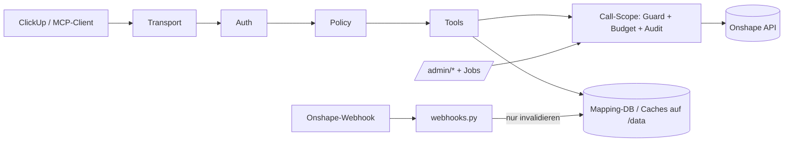
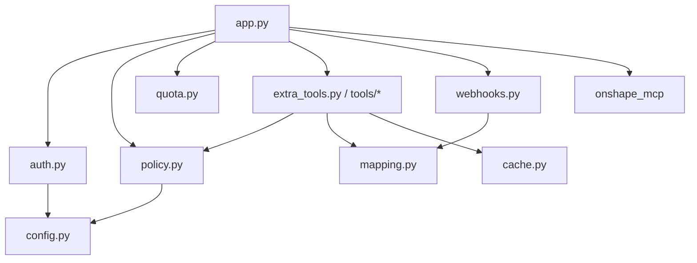
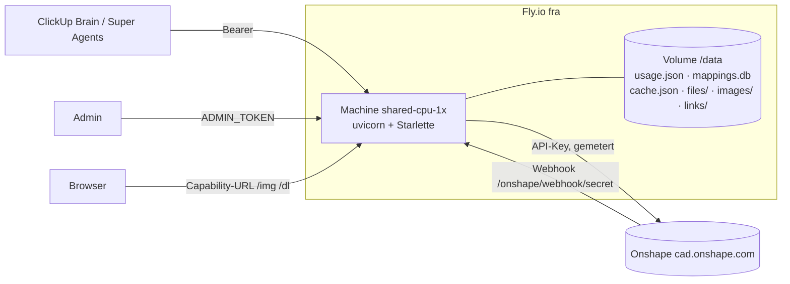
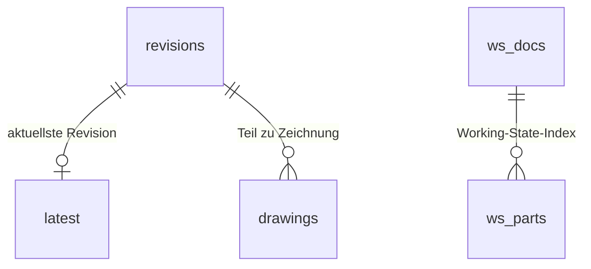

# Architecture Spine — onshape-mcp-secure

Die Spine beschreibt den **Sollzustand**. Wo der Code heute abweicht, steht der Punkt im Hardening-Backlog (H-n) am Ende. Neuer Code folgt der Spine, nicht der Abweichung.

## Design Paradigm

**Policy-Enforcing Gateway.** Ein dünner, gehärteter Server sitzt zwischen MCP-Clients (ClickUp) und Onshape. Jede Anfrage durchläuft dieselben Schichten in fester Reihenfolge. Der Upstream-Kern liefert Tools, entscheidet aber nichts.

| Schicht | Ort | Aufgabe |
| --- | --- | --- |
| Transport | `app.py` (`/mcp` Streamable HTTP, stateless; Legacy-SSE) | MCP-Protokoll, Routen |
| Auth | `auth.py` | Bearer-Token → Client-Label |
| Policy | `policy.py` | Tool-Klasse, Argument-Sanitizing, Dokumentzugriff |
| Call-Scope, Metering & Guard | `app.py` (`_metered`, `get_bytes`), `quota.py` | Budget, Rate-Limit, HTTP-Write-Guard, Audit |
| Tools | `src/onshape_mcp/` (Upstream), `src/onshape_secure/extra_tools.py` → `tools/*` (eigene) | Fachlogik |
| Persistenz | `mapping.py`, `cache.py`, `images.py`, `quota.py` → `/data` | Mapping-Tabelle, Caches, Links, Zähler |



## Invariants & Rules

### AD-1 — Upstream bleibt unverändert [ADOPTED]

- **Binds:** `src/onshape_mcp/`, alle Features
- **Prevents:** Fork-Drift, verlorener Update-Pfad, Sicherheitslogik versteckt im Fremdcode
- **Rule:** `src/onshape_mcp/` wird nie editiert. Verhalten wird im Wrapper geändert: Methoden des Upstream-Clients ersetzen, Schemas säubern, Tools durch eigene Implementierung ersetzen (wie `get_parts`). Ein Upstream-Update kopiert den neuen Stand komplett und lässt beide Testsuiten laufen. Kein Modul außer `app.py` importiert `onshape_mcp`.

### AD-2 — Default deny für Tools [ADOPTED]

- **Binds:** `policy.py` `TOOL_CLASSES`, alle Tools
- **Prevents:** neue oder unbekannte Tools werden ungeprüft an Clients veröffentlicht
- **Rule:** Ein Tool wird nur veröffentlicht, wenn es in `TOOL_CLASSES` einer Klasse zugeordnet ist (`read`, `index`, `featurescript`, `meta`, `create_document`, `write`, `delete`; `system` ist nie per Tool erreichbar) und `is_tool_enabled` es zulässt (`WRITE_MODE`, `ALLOW_*`, `DISABLED_TOOLS`, Read-Scope). Unbekannte Upstream-Tools bleiben gesperrt (`test_every_upstream_tool_is_classified`). Doppelte Tool-Namen brechen den Start ab.

### AD-3 — Ein Call-Scope für jeden Onshape-Zugriff

- **Binds:** Tools, Admin-Endpunkte, Hintergrundjobs, `app.py`
- **Prevents:** Budget-Verbrauch oder Schreib-Requests an Guard und Zählung vorbei; unterschiedliche Kostenangaben je Aufrufer
- **Rule:** Onshape wird ausschließlich über den von `app.py` gewrappten Client angesprochen (alle HTTP-Verben, inkl. `get_bytes` und interner Hilfen wie `fetch_document_name`). Kein eigener httpx-Client. Jeder Request läuft durch `check_onshape_request`, reserviert eine Budget-Einheit vor dem Senden und erstattet sie bei 4xx/5xx/Transportfehler zurück. Tools, Admin-Endpunkte und Jobs öffnen denselben Call-Scope (Akteur, Klasse, Dokument) und schreiben dieselbe JSON-`AUDIT`-Zeile. Kosten werden überall als abgerechnete Calls gemeldet (`onshapeCalls` / `billed`).

### AD-4 — Budget ist die knappste Ressource [ADOPTED]

- **Binds:** jedes Feature, jede Tool-Beschreibung
- **Prevents:** ein Feature verbraucht das Jahresbudget (2.500 Calls firmenweit)
- **Rule:** Reihenfolge der Datenquellen: Mapping-DB → Caches nach AD-12 → Onshape. Kein „Erkunden“ (list/search als Suchstrategie). Batch-Endpunkte vor Einzelabfragen. Gleiche parallele Anfragen teilen sich einen Request (Single-Flight-Lock pro Ressourcenschlüssel). Jedes Tool nennt in Beschreibung oder Docstring seine maximalen Onshape-Calls pro Aufruf. Limits (500/Tag, 600/Woche, 1000/Monat, 2400/Jahr) stehen in `fly.toml` und ändert nur Eric. Jedes Tool-Ergebnis endet mit der `[Onshape-API: …]`-Zeile.

### AD-5 — Schreibzugriff ist aus und wird nicht ausgebaut [ADOPTED]

- **Binds:** `write`/`delete`/`create_document`-Klassen, `check_onshape_request`, `config.py`
- **Prevents:** Modelländerungen durch Agents; schleichende Erweiterung von Schreibpfaden
- **Rule:** `WRITE_MODE=off` in Produktion und als Code-Default. Der HTTP-Guard lässt POST/DELETE nur für (a) dokumentierte Read-only-POSTs (`/featurescript`, `/translations` mit `storeInDocument=false`), (b) Webhook-Verwaltung unter Klasse `system`, (c) Schreib-Tools auf genau das gegatete Dokument durch. Modellier-Tools (Skizzen, Features, Mates) bleiben dauerhaft gesperrt. Künftige Schreibfälle (Freigaben erstellen, Metadaten pflegen) kommen nur als neue, schmale Tool-Klasse mit eigener Spec, Tests und Erics OK. FeatureScript-Auswertung ist eine bewusste Lese-Fähigkeit (Onshape wertet ohne Modelländerung aus).

### AD-6 — Mapping-DB ist alleiniger Eigentümer der Teile-Daten

- **Binds:** `mapping.py`, alle Tool-Module, `cache.py`
- **Prevents:** zwei Wahrheiten für Teilenummer → Revision → Dokument → Zeichnung; zwei Schreiber mit unterschiedlichen Regeln für dieselbe Zeile
- **Rule:** Teilenummern, Revisionen, Latest-Zeiger, Teil→Zeichnung-Links und der Working-State-Index leben nur in `mappings.db`. Pro Tabelle und Zeilenart gibt es genau eine Schreibfunktion in `mapping.py`; Auflösungsregeln (z. B. „Teil vor Zeichnung bei untypisierter Teilenummer“) stehen dort genau einmal. Freigabestatus und freigegebene Revision kommen nur aus `revisions`/`latest`, nie aus `ws_parts`. Neuer Code legt keine Teile-Daten im KV-Cache ab.

### AD-7 — Webhooks invalidieren nur und erhöhen nie Vertrauen

- **Binds:** `webhooks.py`, `mapping.py`
- **Prevents:** gefälschte oder fremde Webhook-Aufrufe schreiben Daten oder verlängern Cache-Laufzeiten
- **Rule:** Webhook-Payloads löschen oder markieren Einträge (`latest`, `drawings`, `ws_docs.dirty`), schreiben aber nie Fachdaten und setzen nie Vertrauensmarker (z. B. `webhook_verified_at`). Die Gesundheit des Webhooks prüft nur ein gemeterter GET. Nach der Registrierung werden nur Events mit bekannter `webhookId` verarbeitet. Ein Release-Event markiert auch das betroffene Dokument im Working-State-Index als dirty. Das Geheimnis im Pfad ist die Credential (konstante Vergleichszeit) und wird nie geloggt. Ohne aktiven Webhook gelten kurze TTLs (1 h / 1 Tag), mit aktivem Webhook 30 Tage.

### AD-8 — Genau eine Instanz [ADOPTED]

- **Binds:** Deployment, `quota.py`, `mapping.py`, Admin-Cooldown, Jobs
- **Prevents:** aufgeteilte Budget-Zähler, konkurrierende SQLite-Schreiber, doppelte Syncs
- **Rule:** Eine Fly-Maschine mit einem Volume `/data`; deployt wird nur mit `--ha=false`. Ohne beschreibbares `/data` startet der Server nicht. Zustand, der Auto-Stop überleben muss (Budget, Cooldowns, Job-Sperren), liegt auf dem Volume (`usage.json`, `mappings.db` `meta`), nicht im Prozess. Wer mehr Instanzen will, braucht zuerst eine neue Architekturentscheidung.

### AD-9 — Zwei Token-Rollen [ADOPTED]

- **Binds:** `auth.py`, `config.py`, `/admin/*`
- **Prevents:** ClickUp-Clients lösen Webhook-Registrierung oder Syncs aus
- **Rule:** Client-Tokens (`MCP_AUTH_TOKENS`, ≥32 Zeichen) dürfen nur MCP. `/admin/*` verlangt das Label `admin` aus `ADMIN_TOKEN`, sonst 403. `/admin/sync` höchstens alle 10 Minuten. Öffentlich ohne Token sind nur `/healthz`, Capability-Links (`/img/`, `/dl/` per GET/HEAD, AD-13) und der Webhook-POST mit Geheimpfad.

### AD-10 — Fail closed, nichts nach außen leaken

- **Binds:** `config.py`, `app.py`, alle Tools
- **Prevents:** eine fehlende Umgebungsvariable öffnet Rechte; Interna oder Secrets landen beim Client oder im Log
- **Rule:** Jede sicherheitsrelevante Umgebungsvariable hat im Code den restriktivsten Default (`WRITE_MODE=off`, `ALLOW_DELETE_FEATURE=false`, `ALLOW_FEATURESCRIPT=false`, `ENABLE_LEGACY_SSE=false`); `fly.toml` schaltet bewusst frei. Ungültige Werte beenden den Start (`ConfigError`). Argumente werden gegen das veröffentlichte Schema validiert, Unbekanntes verworfen. Unerwartete Fehler gehen als generische Meldung an den Client. loguru läuft ohne `diagnose`/`backtrace`, Produktion nie auf `DEBUG`. Secrets, Webhook-Pfad und Link-Tokens erscheinen nie vollständig in Logs, Doku oder Commits.

### AD-11 — Ein Tool, eine Registrierung pro Fachmodul

- **Binds:** neue Tools, `extra_tools.py`, `policy.py`
- **Prevents:** Tools, die in einer von mehreren Listen fehlen (Schema, Klasse, Handler); ein weiter wachsendes Sammelmodul
- **Rule:** Neue eigene Tools kommen in ein Modul pro Fachbereich (z. B. `tools/exports.py`, `tools/drawings.py`), das Schema, Klasse, Handler und maximale Onshape-Calls zusammen registriert. Kein Big-Bang-Umbau: `extra_tools.py` wird aufgeteilt, wenn das nächste größere Feature es berührt. Bis dahin muss jedes neue Tool in `TOOLS`, `TOOL_CLASSES`, `EXTRA_TOOL_NAMES` und `handler()` stehen; ein Test prüft, dass die Listen übereinstimmen.

### AD-12 — Feste Cache-Ebenen

- **Binds:** `cache.py`, `mapping.py`, alle Tool-Module
- **Prevents:** Daten landen im falschen Speicher, verdrängen sich gegenseitig oder veralten unbemerkt
- **Rule:** Es gibt genau diese Ebenen; neue Daten werden einer davon zugeordnet:

| Ebene | Speicher | Schlüssel | Lebensdauer |
| --- | --- | --- | --- |
| Fachdaten | `mappings.db` | Teilenummer, Revision, Dokument-ID | nach AD-6/AD-7 (Webhook-Invalidierung, TTL) |
| Unveränderliche Metadaten | `cache.json` (KV) | nur unveränderliche Onshape-IDs (Version-ID, Release-Paket-ID, Company-ID) | unbefristet |
| Laufende Jobs | `cache.json` (KV) | Job-Schlüssel | kurz (`PENDING_TTL`) |
| Dateien (STEP, PDF, Renders, CSV) | `files/` | Hash aus unveränderlichen IDs + Parametern | `FILE_CACHE_HOURS` (24 h), Größenlimit |
| Capability-Links | `images/`, `links/` | Zufallstoken | AD-13 |

Unveränderliche Einträge werden nie über Teilenummern oder Namen verschlüsselt. Im KV gibt es keine unbegrenzten Schlüsselräume (z. B. ein Eintrag pro Teil ohne TTL).

### AD-13 — Capability-Links

- **Binds:** `images.py`, `cache.py` `DownloadLinks`, `auth.py`
- **Prevents:** erratbare, ewig gültige oder in Logs auslesbare Links auf CAD-Dateien
- **Rule:** Link-Token haben mindestens 192 Bit Zufall, gelten höchstens 168 h (Default 24 h) und sind nicht widerrufbar; deshalb bleibt die TTL kurz. Antworten tragen `no-store`, `nosniff`, `noindex`, `no-referrer` und (außer PDF) eine Sandbox-CSP. Geloggt wird nur ein Token-Präfix.

### AD-14 — Onshape-Daten und Agent-Eingaben sind nicht vertrauenswürdig

- **Binds:** alle Tools, `policy.py`
- **Prevents:** Prompt-Injection über Teilenamen, Beschreibungen oder Tool-Argumente erweitert die Wirkung eines Agents
- **Rule:** Der maximale Schaden eines manipulierten Agents ist: lesen im Read-Scope, Budget verbrauchen. Darüber hinaus gibt es keinen Kanal nach außen außer Onshape und Capability-Links. Kein Tool folgt URLs aus Daten, verschickt Nachrichten oder schreibt. Ist ein Read-Scope gesetzt (`READ_ALLOWED_DOCUMENT_IDS`), prüft jedes Tool jedes Dokument, das es liest (`check_read`). Tools, die dokumentübergreifend listen (Mapping-DB, Teile-Index, Dokumentliste/-suche), haben die Klasse `index` und sind bei gesetztem Read-Scope über die Klasse gesperrt, nicht über eine Namensliste.

### Abhängigkeitsrichtung



Tool-Module rufen Onshape nur über den Client auf, den `app.py` injiziert.

## Consistency Conventions

| Thema | Konvention |
| --- | --- |
| Sprache | Code, Kommentare, Tool-Beschreibungen, Commits auf Englisch; Nutzer-Doku (`docs/`) und BMAD-Artefakte auf Deutsch |
| IDs | Onshape-Dokument/Workspace/Element-IDs: 24 Zeichen hex, kleingeschrieben (`ONSHAPE_ID_RE`); Teilenummern über `PART_NUMBER_RE` |
| Fehler an Agents | `PolicyDenied` / `QuotaExceeded` mit klarer Handlungsanweisung („Tell the user; do not retry“); Ausgabe als `Denied: …` mit `isError` |
| Tool-Ergebnis | Text/Image-Content, gekürzt auf `MAX_RESPONSE_CHARS`; Screenshots und Exporte als Markdown-Link (Capability-URL); letzte Zeile ist immer die `[Onshape-API: …]`-Zeile |
| Audit | Eine `AUDIT`-Zeile mit JSON-Objekt pro Tool-Call, Admin-Aktion und Job (Akteur, Aktion, Klasse, Entscheidung, `onshapeCalls`, Dauer) |
| Konfiguration | Nur über Umgebungsvariablen in `config.py`, mit Bereichsprüfung und restriktivem Default; Nicht-Secrets in `fly.toml [env]`, Secrets nur über `fly secrets` |
| Persistenz | Alles Dauerhafte unter `/data`; atomares Schreiben (tmp + `os.replace`); SQLite im WAL-Modus; Schemaänderungen nur additiv (`CREATE … IF NOT EXISTS`, `INDEX_VERSION`) |
| Onshape-API-Pfade | Mit expliziter API-Version (`/api/v6/…` oder neuer), nicht unversioniert |
| CSV-Exporte | Jede Zelle durch `_csv_safe` (Formel-Neutralisierung) |
| Tests | Sicherheitsrelevante Änderungen (Auth, Guard, Sanitizing, Budget, Defaults) bekommen Tests; E2E gegen Fake-Onshape per httpx `MockTransport`, nie gegen das echte Onshape |

## Betrieb

| Thema | Entscheidung |
| --- | --- |
| Umgebungen | Nur Produktion (`pikes-onshape-mcp`) plus lokale Läufe mit Fake-Onshape in den Tests. Keine Staging-App, weil jeder echte Onshape-Call Budget kostet |
| Deploy | Manuell, KI-gestützt: `python -m pytest -q tests` grün → `fly deploy -a pikes-onshape-mcp --ha=false` → `/healthz` prüfen → MCP-Verbindung in ClickUp aktualisieren, wenn Tools neu sind |
| Rollback | `fly releases` / erneuter Deploy des vorherigen Commits; Datenformate auf `/data` bleiben abwärtskompatibel (additive Schemas) |
| Secrets | `ONSHAPE_ACCESS_KEY`, `ONSHAPE_SECRET_KEY`, `MCP_AUTH_TOKENS`, `ADMIN_TOKEN` nur in `fly secrets`. Rotation: neues Secret setzen, deployen, altes widerrufen. Das Webhook-Geheimnis liegt in `mappings.db` und wird rotiert, indem der Webhook neu registriert wird |
| Logs | `fly logs` mit `AUDIT`-Zeilen; keine eigene Log-Aufbewahrung |
| Abhängigkeiten | Hash-gepinnt (`--require-hashes`), Base-Image per Digest; Auffrischung bei Sicherheitsmeldungen oder spätestens halbjährlich |
| Backups | Fly-Volume-Snapshots bleiben an (täglich, 5 Tage): sichern Mapping-DB und Budget-Zähler. Dateien darin sind höchstens 24 h alt (AD-12) |
| Monitoring | Fly-Healthcheck auf `/healthz`. Budget-Warnung: ab 80 % des Monats- oder Jahresbudgets hängt die `[Onshape-API: …]`-Zeile einen Warnhinweis an, den der Agent weitergibt; kein eigener Benachrichtigungskanal (AD-14) |

## Stack

| Name | Version | Status (geprüft 2026-10-15) |
| --- | --- | --- |
| Python | 3.12 (`python:3.12-slim-bookworm`, per Digest gepinnt) | nur Security-Fixes bis 2028-10; Debian bookworm in LTS |
| mcp (Python SDK) | 1.30.0, auf `<2` begrenzt | 1.x nur noch Wartung; 2.x stabil seit 2026-07 |
| Starlette | 1.8.0 | keine bekannten Schwachstellen |
| uvicorn | 0.54.0 | keine bekannten Schwachstellen |
| httpx | 0.28.1 | keine bekannten Schwachstellen |
| loguru | 0.7.3 | keine bekannten Schwachstellen |
| SQLite | stdlib `sqlite3` | – |
| Upstream | hedless/onshape-mcp, Commit `a9c2a5e` (MIT) | – |
| Hosting | Fly.io, App `pikes-onshape-mcp`, Region `fra`, shared-cpu-1x / 512 MB, Auto-Stop | – |

Quellen und Details: `reviews/review-versions.md`.

## Structural Seed





`meta` (Company-ID, Webhook-IDs und -Geheimnis, Sync-Stand, Cooldowns) steht ohne Beziehungen daneben.

```text
src/
  onshape_mcp/        # Upstream, unverändert (AD-1)
  onshape_secure/
    app.py            # Transport, Call-Scope, Admin, Routen
    auth.py config.py policy.py quota.py
    mapping.py webhooks.py cache.py images.py
    extra_tools.py    # eigene Tools; wird nach AD-11 in tools/* aufgeteilt
tests/                # eigene Tests (unit + e2e mit Fake-Onshape)
upstream_tests/       # Upstream-Tests
_bmad-output/         # BMAD-Artefakte
docs/                 # Nutzer-Doku (Deutsch)
```

## Hardening-Backlog (Code weicht heute ab)

| ID | Abweichung | Regel |
| --- | --- | --- |
| H-1 | Code-Defaults offen: `WRITE_MODE=allowlist`, `ALLOW_DELETE_FEATURE`, `ALLOW_FEATURESCRIPT`, `ENABLE_LEGACY_SSE` = true; gesetztes `DISABLED_TOOLS` hebt Export-Sperre auf | AD-10, AD-5 |
| H-2 | KV-Fallbacks für Teile-Daten in `_revision`, `_drawings_where_used`, `_locate_by_where_used` | AD-6, AD-12 |
| H-3 | `put_revision` und `put_synced_revision` lösen `latest[pn,'']` unterschiedlich auf | AD-6 |
| H-4 | **Erledigt 2026-10-15** (war: `ping`/`register` setzten `webhook_verified_at`; Events ohne `webhookId` akzeptiert; Release-Events ohne `ws_docs`-dirty). Offen: Gate öffnet wieder, wenn der Webhook verschwindet (deferred-work.md); ob Release-Events `documentId` tragen, zeigt das Log-Feld `doc=yes/no` | AD-7 |
| H-5 | `fetch_document_name` umgeht `check_onshape_request`; nur get/post/delete gewrappt | AD-3 |
| H-6 | Admin-Audit als Freitext; Kosten mal als Requests, mal als billed; Sync-Cooldown nur im Prozess | AD-3, AD-8 |
| H-7 | Server startet ohne beschreibbares `/data` (Caches/Mapping still aus) | AD-8 |
| H-8 | **Erledigt 2026-10-15** (war: `auth_failed` loggte den vollen Pfad mit Webhook-Geheimnis/Link-Token; jetzt Präfix + 6 Zeichen, Access-Log explizit aus) | AD-10, AD-13 |
| H-9 | **Erledigt 2026-10-15** (war: `find_drawing_for_part` / `_find_unreleased` ohne `check_read`; Read-Scope über Namensliste statt Klasse `index`) | AD-14 |
| H-10 | **Erledigt 2026-10-15** (war: kein Test für Übereinstimmung der Tool-Registrierungslisten; doppelte Namen überschrieben still) | AD-2, AD-11 |
| H-11 | `/api/webhooks` ohne API-Version | Konvention Onshape-API-Pfade |
| H-12 | Budget-Warnung ab 80 % fehlt in der Verbrauchszeile | Betrieb/Monitoring |
| H-13 | README empfiehlt, Volume-Snapshots abzuschalten | Betrieb/Backups |

## Deferred

| Thema | Warum es warten kann / Auslöser |
| --- | --- |
| Schreib-Use-Cases (Freigaben, Metadaten) | Kein aktueller Bedarf; kommt mit eigener Spec und neuer Tool-Klasse (AD-5) |
| Aufteilung `extra_tools.py` in `tools/*` | Beim nächsten größeren Feature (AD-11) |
| CI/CD-Pipeline | Bewusst manuell; neu bewerten, wenn mehrere Leute deployen |
| Skalierung über eine Instanz hinaus | Kein Bedarf (AD-8) |
| MCP SDK 2.x | Migration, wenn ClickUp die Spec-Revision 2026-07-28 verlangt, 1.x keine Security-Fixes mehr bekommt oder Upstream umstellt |
| Base-Image auf Debian trixie / Python 3.13 | Beim nächsten Abhängigkeits-Refresh, spätestens vor 2028-06 |
| Legacy-SSE abschalten | Im Spec deprecated; abschalten, sobald die Logs zeigen, dass ClickUp nur `/mcp` nutzt |
| Webhook-HMAC-Signaturen von Onshape | Prüfen, ob unser Onshape-Plan sie bietet; dann zusätzlich zum Geheimpfad |
| Upstream-Update-Rhythmus | Nach Bedarf; Ablauf steht in README und AD-1 |
